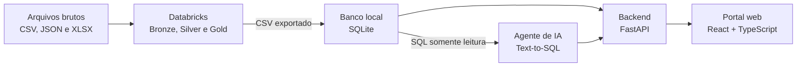

# V-Energy Grid 360

Plataforma para integrar dados de unidades consumidoras, consumo, faturamento, continuidade do serviço e
atendimento da V-Energy.

Projeto do case final do Rocket Lab 2026.2 (Visagio). A plataforma é o meio; o que o cliente quer é a resposta à
pergunta da diretoria comercial: **por que a receita subiu só cerca de 8%, se a tarifa subiu 10,5% e o volume
faturado caiu cerca de 4%?**

## Visão geral



| Módulo | O que entrega | Frente |
|---|---|---|
| Engenharia de Dados | Pipeline Bronze → Silver → Gold no Databricks e exportação para o banco local | Dados |
| Portal web | Dashboards, visão 360 da unidade consumidora, fila e ordens de inspeção, DEC/FEC | Dev |
| Inteligência Artificial | Agente conversacional (Text-to-SQL) e insights dentro do portal | IA |
| Diagnóstico da receita | Explicação da variação de receita, com recomendações | Todos |

## Estrutura do repositório

| Pasta | Conteúdo | Frente |
|---|---|---|
| `data-engineering/` | Notebooks Databricks (Bronze → Silver → Gold) e YAML do Workflow | Dados |
| `backend/` | API FastAPI do portal | Dev |
| `frontend/` | React + TypeScript (Vite) | Dev |
| `ai-agent/` | Agente Text-to-SQL | IA |
| `docs/` | Dicionário de dados, log de qualidade, contrato da Gold, diagnóstico da receita | Todos |

## Como rodar

### Frontend

Requisitos: Node.js 24+ e npm.

```bash
cd frontend
npm ci
npm run dev
```

Acesse http://localhost:5173 ou o endereço indicado no terminal.
Mais comandos no [README do frontend](frontend/README.md).

### Backend

Requisitos: Python 3.11+.

```bash
cd backend
python -m venv .venv
# Windows (PowerShell): .venv\Scripts\Activate.ps1
# Linux/macOS:          source .venv/bin/activate
pip install -r requirements.txt
cp .env.example .env     # opcional: o padrão já usa dados mockados
uvicorn app.main:app --reload --port 8000
```

Documentação interativa da API: http://localhost:8000/docs. Testes: `python -m pytest -q`.

O backend usa **dados fictícios** por padrão (`DATA_SOURCE=mock`). Com `DATA_SOURCE=sqlite`,
lê o arquivo Gold configurado; a leitura dos blocos da Visão 360 está implementada,
mas ainda depende de homologação com a exportação oficial.
Detalhes no [README do backend](backend/README.md).

### Frontend e backend juntos

Abra dois terminais: o frontend em `http://localhost:5173` e o backend em `http://localhost:8000`.
O CORS do backend já aceita o frontend nesse endereço.

### Dados (Databricks)

O pipeline roda inteiro no Databricks (Free Edition, computação serverless), em PySpark, com a arquitetura medalhão:

| Camada | O que faz | Resultado |
|---|---|---|
| **Landing** | os 12 arquivos brutos do case, num Volume | `/Volumes/v_energy/bronze/landing` |
| **Bronze** | leitura pura, tudo como texto, com `source_file` e `ingestion_timestamp` | 8 tabelas em `v_energy.bronze` |
| **Silver** | limpeza e padronização; cada problema e cada decisão estão no [log de qualidade](docs/data_quality_log.md) | 9 tabelas em `v_energy.silver` (os atendimentos viram 2: chamados e tratativas) |
| **Gold** | tabelas modeladas a partir das perguntas das lideranças ([contrato da Gold](docs/gold_contract.md)) | 10 tabelas em `v_energy.gold` |
| **Export** | CSV de cada tabela Gold + banco SQLite com conferência das contagens | `gold.db.zip` no Volume `v_energy.gold.export` |

#### Passo a passo

1. **Repositório no Databricks:** em *Workspace*, crie um **Git folder** apontando para este repositório.
2. **Ambiente:** rode `data-engineering/notebooks/00_organizacao_do_ambiente`. Ele cria o catálogo `v_energy`, os schemas `bronze`, `silver` e `gold` e o Volume `landing` (tudo `IF NOT EXISTS`).
3. **Dados de origem:** em *Catalog → v_energy → bronze → landing → Upload to this volume*, envie os 7 arquivos da raiz do `.zip` do case e, numa pasta `leituras/` dentro do Volume, os 5 arquivos de leituras. Rode de novo o `00` para validar que estão todos lá. **Os dados são confidenciais e nunca vão para o GitHub.**
4. **Workflow:** rode `data-engineering/workflow/criar_workflow.ipynb`. Ele cria (ou atualiza) o Job `v_energy_pipeline` com as 21 tarefas e as dependências. Com `USAR_GIT = True` (padrão), o Job lê os notebooks da branch `main` do GitHub.
5. **Execução:** em *Jobs & Pipelines → v_energy_pipeline*, clique em **Run now** (cerca de 14 minutos).
6. **Banco do portal e do agente:** em *Catalog → v_energy → gold → Volumes → export*, baixe o `gold.db.zip`, descompacte e coloque o `gold.db` em `backend/data/gold.db` (`DATA_SOURCE=sqlite`). O `gold.db` e os CSVs **não são versionados**.

Também é possível rodar os notebooks à mão, na ordem: `00` → `01` → `02_silver_*` → `03_gold_*` → `04_export_banco_local`. A ordem entre eles está na tabela de dependências do [`criar_workflow.ipynb`](data-engineering/workflow/criar_workflow.ipynb).

#### Workflow

O Job `v_energy_pipeline` está definido em [`data-engineering/workflow/v_energy_pipeline.yaml`](data-engineering/workflow/v_energy_pipeline.yaml): ambiente → Bronze → 8 Silvers → 10 Golds → export. Cada tarefa só começa quando as tabelas que ela lê estão prontas, e as independentes rodam em paralelo.


#### Estratégia de agendamento

**Mensal, no dia 3, às 03:00 (America/Recife)**, hoje **pausado**.

- **Por que mensal:** leituras e faturas são por **competência mensal**, e todas as perguntas do case (receita, KPIs, DEC e FEC) são apuradas por mês. Rodar todo dia gastaria computação para produzir quase os mesmos números.
- **Por que no dia 3:** 99,5% das faturas são emitidas no próprio mês da competência (log F4), então no começo do mês seguinte a competência anterior já está fechada; o dia 3 dá margem às atrasadas.
- **Por que de madrugada:** fora do expediente; o portal amanhece com o mês novo.
- **Por que pausado:** a base do case é uma extração única. O agendamento fica pronto para produção, e a execução da entrega foi manual.
- **Reprocessamento completo:** todas as tabelas são regravadas (`overwrite`). Rodar de novo dá o mesmo resultado, e os pagamentos atrasados atualizam faturas de meses anteriores.
- **Falha não chega ao portal:** se uma checagem de qualidade falha, o notebook para com erro, as tarefas seguintes e o export não rodam, e o portal continua com os dados do mês anterior. Também há 1 nova tentativa por tarefa (para quedas momentâneas), timeout de 1 hora, uma execução por vez e e-mail em caso de falha.
- **Evolução possível:** se a operação ou o atendimento precisarem acompanhar o mês em andamento, uma execução mais frequente só das tabelas de rede e de chamados.

#### Qualidade dos dados

Todo notebook Silver e Gold termina com checagens automáticas (`dq_check`): contagens, chaves únicas, domínios, nulos, coerência entre colunas e **reconciliação** (as somas da Gold fecham com as Silvers, e os números do diagnóstico são reproduzidos ao centavo). O resultado de cada execução é gravado em `v_energy.silver.dq_log`, e **a tabela só é gravada se todas passarem**. Só nas 10 Golds são 372 checagens.

#### Documentação de dados

- [Dicionário de dados da Gold](docs/dicionario_dados/README.md): as 10 tabelas, coluna a coluna, com as decisões de limpeza que afetam cada número e os cuidados de uso.
- [Log de qualidade](docs/data_quality_log.md): cada problema encontrado nos dados brutos e a decisão tomada.
- [Contrato da Gold](docs/gold_contract.md): as perguntas do case e a tabela que responde a cada uma.
- [Diagnóstico da receita](docs/diagnostico_receita.md): a resposta à pergunta do Diretor Comercial.

### Agente de IA

> **A preencher pela frente de IA:** como configurar as chaves e executar o agente.

## Documentação

- [Arquitetura do backend](backend/docs/arquitetura-backend.md): pastas, rotas e fluxo do agente de IA.
- [O que o portal precisa da Gold](backend/docs/contrato-gold.md).
- [README do backend](backend/README.md) e [README do frontend](frontend/README.md).
- [Diagnóstico da receita](docs/diagnostico_receita.md), [dicionário de dados](docs/dicionario_dados/README.md), [log de qualidade](docs/data_quality_log.md) e [contrato da Gold](docs/gold_contract.md).

## Decisões e suposições

- Stack básica, só frontend e backend, sem cache externo (como o Redis).
- Mock e SQLite compartilham o contrato da API. Os campos e limites da integração estão no [mapeamento da Gold](backend/docs/contrato-gold.md).
- Na Visão 360, DEC/FEC usam os indicadores mensais da Gold e apresentam o contexto do alimentador; o histórico de interrupções descreve a própria UC.
- O efeito-preço da variação de receita inclui reajuste, bandeira tarifária e mudança de mix entre classes.
- As ordens de inspeção persistem em `portal.db`, separado da Gold, e sobrevivem a reinícios.

### Dados

- **Bronze preserva a origem:** tudo é lido como texto, sem inferir tipos, e nada é removido. Toda limpeza acontece na Silver, e a Bronze continua com as linhas originais.
- **Registros órfãos são removidos na Silver** (faturas e leituras de UCs ou medidores que não existem no cadastro): a receita fica ~1,5% menor que a da Bronze, e a variação de receita do diagnóstico é +8,00% (seria +7,90% com elas).
- **As 200 UCs de teste são removidas** (ativas, mas sem medidor, leitura nem fatura). A base fica com 45.000 UCs, o número do case.
- **Datas em vários formatos:** cada padrão é convertido com o seu formato, confirmado contra um gabarito (hífen = mês primeiro; ponto e barra = dia primeiro). Códigos de ausência (`N/A`, `NULL`, `-1`) e a data coringa `9999-12-31` viram nulo.
- **Troca de medidor:** no mês da troca, o consumo é a leitura do medidor novo. É a única regra que reproduz o "quase −4%" do diretor.
- **Receita = `valor_energia`, sem tributos.** A variação é a mesma com o valor total (+8,00%).
- **Períodos do diagnóstico:** primeiro ano = `2022-07` a `2023-06`; últimos 12 meses = `2025-07` a `2026-06`. "No último ano" compara com `2024-07` a `2025-06`.
- **Geração distribuída:** o consumo faturado já vem **líquido da GD** (cai ~69% depois da conexão); é uma associação medida, não um campo do sistema. Uma UC "tem GD no mês" a partir do mês da conexão, inclusive.
- **DEC e FEC são simplificados**, como o glossário do case permite: cada registro de ocorrência é uma UC interrompida. Servem para comparar alimentadores e períodos, **não** para comparar com os limites da ANEEL. A oscilação entra no cálculo; a ocorrência sem causa informada conta como **não evitável** (as horas evitáveis são um piso); e 584 ocorrências (0,3%) registradas antes da ligação da UC foram mantidas (log X1).
- **Chave da UC:** `id_uc`, sem chave substituta: é único, estável e usado em todas as tabelas.
- **LGPD:** nome e documento do titular só existem mascarados na Gold, no portal e no agente.
- **Fila de inspeção:** os sinais seguem o contrato da Gold, mas os pesos e os limiares da regra `v1` são decisão do time, validada só retrospectivamente nas 1.389 inspeções da base.
- **Checagens com números desta extração:** várias checagens usam contagens fixas (45.000 UCs, 180.000 ocorrências). Com dados novos, elas precisariam virar regras relativas (não diminuir, fechar com a Silver).

> Cada frente acrescenta aqui as suas decisões e suposições.

## Como contribuir

- Uma branch por tarefa (`dados/...`, `dev/...`, `ia/...`) e PR para `main` com 1 revisão.
- Mensagens de commit no formato `tipo(escopo): descrição` (por exemplo, `feat(backend): ...`).
- Nunca versionar dados brutos, o PDF do case ou credenciais (veja o `.gitignore`).
