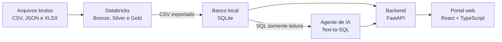

# V-Energy Grid 360

Plataforma para integrar dados de unidades consumidoras, consumo, faturamento, continuidade do serviço e
atendimento da V-Energy.

Projeto do case final do Rocket Lab 2026.2 (Visagio). A plataforma é o meio; o que o cliente quer é a resposta à
pergunta da diretoria comercial: **por que a receita subiu só cerca de 8%, se a tarifa subiu 10,5% e o volume
faturado caiu cerca de 4%?**

## Visão geral



| Módulo | O que entrega | Frente |
|---|---|---|
| Engenharia de Dados | Pipeline Bronze → Silver → Gold no Databricks e exportação para o banco local | Dados |
| Portal web | Dashboards, visão 360 da unidade consumidora, fila e ordens de inspeção, DEC/FEC | Dev |
| Inteligência Artificial | Agente conversacional (Text-to-SQL) e insights dentro do portal | IA |
| Diagnóstico da receita | Explicação da variação de receita, com recomendações | Todos |

## Estrutura do repositório

| Pasta | Conteúdo | Frente |
|---|---|---|
| `data-engineering/` | Notebooks Databricks (Bronze → Silver → Gold) e YAML do Workflow | Dados |
| `backend/` | API FastAPI do portal | Dev |
| `frontend/` | React + TypeScript (Vite) | Dev |
| `ai-agent/` | Agente Text-to-SQL | IA |
| `docs/` | Dicionário de dados, log de qualidade, contrato da Gold, diagnóstico da receita | Todos |

## Como rodar

### Frontend

Requisitos: Node.js 24+ e npm.

```bash
cd frontend
npm ci
npm run dev
```

Acesse http://localhost:5173 ou o endereço indicado no terminal.
Mais comandos no [README do frontend](frontend/README.md).

### Backend

Requisitos: Python 3.11+.

```bash
cd backend
python -m venv .venv
# Windows (PowerShell): .venv\Scripts\Activate.ps1
# Linux/macOS:          source .venv/bin/activate
pip install -r requirements.txt
cp .env.example .env     # opcional: o padrão já usa dados mockados
uvicorn app.main:app --reload --port 8000
```

Documentação interativa da API: http://localhost:8000/docs. Testes: `python -m pytest -q`.

**Atenção:** enquanto a camada Gold não estiver pronta, o backend responde com **dados fictícios**
(`DATA_SOURCE=mock`). Nenhum número exibido por ele vem do dado real da V-Energy.
Detalhes no [README do backend](backend/README.md).

### Frontend e backend juntos

Abra dois terminais: o frontend em `http://localhost:5173` e o backend em `http://localhost:8000`.
O CORS do backend já aceita o frontend nesse endereço.

### Dados (Databricks)

> **A preencher pela frente de Dados:** passo a passo para executar o pipeline, print da execução bem-sucedida do
> Workflow, estratégia de agendamento e link para o dicionário de dados.

### Agente de IA

> **A preencher pela frente de IA:** como configurar as chaves e executar o agente.

## Documentação

- [Arquitetura do backend](backend/docs/arquitetura-backend.md): pastas, rotas e fluxo do agente de IA.
- [O que o portal precisa da Gold](backend/docs/contrato-gold.md).
- [README do backend](backend/README.md) e [README do frontend](frontend/README.md).
- `docs/`: dicionário de dados, contrato da Gold e diagnóstico da receita (em construção).

## Decisões e suposições

- Stack básica, só frontend e backend, sem cache externo (como o Redis).
- O backend usa dados mockados até a Gold ficar pronta; a leitura do banco real entra depois, sem mudar as rotas.
- DEC e FEC são simplificados, como no enunciado: servem para comparar alimentadores e períodos.
- O efeito-preço da variação de receita inclui reajuste, bandeira tarifária e mudança de mix entre classes.
- As ordens de inspeção ficam em memória por enquanto (somem ao reiniciar o servidor).

> Cada frente acrescenta aqui as suas decisões e suposições.

## Como contribuir

- Uma branch por tarefa (`dados/...`, `dev/...`, `ia/...`) e PR para `main` com 1 revisão.
- Mensagens de commit no formato `tipo(escopo): descrição` (por exemplo, `feat(backend): ...`).
- Nunca versionar dados brutos, o PDF do case ou credenciais (veja o `.gitignore`).