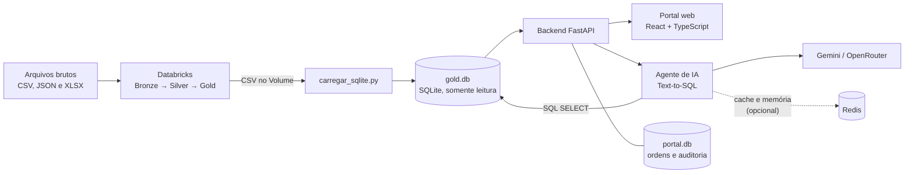

# V-Energy Grid 360

Plataforma que integra unidades consumidoras, medição, faturamento, rede e atendimento da V-Energy numa única
fonte de dados, com portal web e um agente de IA que responde perguntas de negócio em português.

Projeto do case final do Rocket Lab 2026.2 (Visagio). A plataforma é o meio, mas o que o cliente quer é a resposta à
pergunta da diretoria comercial: **por que a receita subiu só cerca de 8%, se a tarifa subiu 10,5% e o volume
faturado caiu cerca de 4%?** A resposta está no [diagnóstico da receita](docs/diagnostico_receita.md) e é
resumida [abaixo](#diagnóstico-da-receita).

## Sumário

- [Visão geral](#visão-geral)
- [Estrutura do repositório](#estrutura-do-repositório)
- [Como executar](#como-executar)
- [Engenharia de dados](#engenharia-de-dados)
- [Portal web](#portal-web)
- [Inteligência artificial](#inteligência-artificial)
- [Diagnóstico da receita](#diagnóstico-da-receita)
- [Dicionário de dados](#dicionário-de-dados)
- [Testes e CI](#testes-e-ci)
- [Decisões e suposições](#decisões-e-suposições)
- [Fora do escopo desta entrega](#fora-do-escopo-desta-entrega)
- [Como contribuir](#como-contribuir)

## Visão geral



| Módulo | O que entrega | Pasta |
|---|---|---|
| Engenharia de dados | Pipeline Bronze → Silver → Gold no Databricks, Workflow e exportação para o banco local | `data-engineering/` |
| Portal web | Dashboard, análise de receita, visão 360 da UC, fila e ordens de inspeção, qualidade do serviço (DEC/FEC) | `frontend/` e `backend/` |
| Inteligência artificial | Assistente conversacional (Text-to-SQL) e insights dentro do portal | `backend/app/agent/` |
| Diagnóstico da receita | Explicação da variação de receita, com recomendações | `docs/` |

## Estrutura do repositório

| Pasta ou arquivo | Conteúdo |
|---|---|
| `data-engineering/` | Notebooks Databricks (`00` a `04`), YAML do Workflow, scripts de carga do SQLite e notebooks de exploração |
| `backend/` | API FastAPI do portal, repositórios mock e SQLite, e o agente de IA em `app/agent/` |
| `frontend/` | Portal em React + TypeScript (Vite) |
| `docs/` | Dicionário de dados, log de qualidade, diagnóstico da receita, guia de Docker e imagens |
| `compose.yaml` | Stack completa: backend, frontend (nginx) e Redis |
| `.github/workflows/ci.yml` | CI: guarda de arquivos e segredos, testes do backend, lint e build do frontend |

## Como executar

Há três caminhos. O **caminho 2 (Docker)** sobe tudo com a Gold real e é o recomendado para avaliar o projeto.
Os dados brutos e o `gold.db` **não** estão no repositório (já que são confidenciais da Visagio). O caminho 1 mostra como
gerá-los.

### 1. Gerar a Gold (Databricks)

1. **Repositório no Databricks:** em *Workspace*, crie um **Git folder** apontando para este repositório.
2. **Ambiente:** rode `data-engineering/notebooks/00_organizacao_do_ambiente`. Ele cria o catálogo `v_energy`, os schemas `bronze`, `silver` e `gold` e o Volume `landing` (tudo `IF NOT EXISTS`).
3. **Dados de origem:** em *Catalog → v_energy → bronze → landing → Upload to this volume*, envie os 7 arquivos da raiz do `.zip` do case e, numa pasta `leituras/` dentro do Volume, os 5 arquivos de leituras. Rode de novo o `00` para validar que estão todos lá. **Os dados são confidenciais e nunca vão para o GitHub.**
4. **Workflow:** rode `data-engineering/workflow/criar_workflow.ipynb`. Ele cria (ou atualiza) o Job `v_energy_pipeline` com as 21 tarefas e as dependências. Com `USAR_GIT = True` (padrão), o Job lê os notebooks da branch `main` do GitHub.
5. **Execução:** em *Jobs & Pipelines → v_energy_pipeline*, clique em **Run now** (cerca de 14 minutos).
6. **Banco do portal e do agente:** em *Catalog → v_energy → gold → Volumes → export*, baixe o `gold.db.zip`, descompacte e coloque o `gold.db` em `backend/data/gold.db` (`DATA_SOURCE=sqlite`). O `gold.db` e os CSVs **não são versionados**.

Também é possível rodar os notebooks à mão, na ordem: `00` → `01` → `02_silver_*` → `03_gold_*` → `04_export_banco_local`. A ordem entre eles está na tabela de dependências do [`criar_workflow.ipynb`](data-engineering/workflow/criar_workflow.ipynb).

Para gerar o `gold.db` a partir dos CSVs:

1. Baixe a pasta do Volume `v_energy.gold.export` (contém `manifesto.json` e `<tabela>/part-*.csv`) para
   `data/gold_csv/` na raiz do repositório. A pasta `data/` é ignorada pelo Git.
2. Gere o banco local e confira:

   ```bash
   python data-engineering/scripts/carregar_sqlite.py --entrada data/gold_csv --saida data/gold/gold.db
   python data-engineering/scripts/conferir_sqlite.py data/gold/gold.db
   ```

   O script cria as tabelas com os tipos do manifesto, confere as contagens e só então troca o banco antigo pelo
   novo: se algo falhar, o banco anterior continua como estava.

### 2. Portal completo com Docker (recomendado)

Pré-requisitos: Docker Desktop (engine Linux) com Compose v2 e a porta 8080 livre. Node e Python não precisam
estar instalados. Detalhes e solução de problemas em [docs/dockerizacao.md](docs/dockerizacao.md).

1. Coloque a Gold em `data/gold/gold.db` (caminho 1, ou o arquivo recebido da frente de Dados).
2. Copie `backend/.env.example` para `backend/.env` e preencha (o Docker lê as configurações desse arquivo; ele
   não é versionado):
   - `GOLD_DATA_VERSION`: identifica o snapshot da Gold (obrigatória, usada pelo cache). Troque o valor sempre
     que carregar um `gold.db` novo.
   - `GEMINI_API_KEY` (e, opcionalmente, `OPENROUTER_API_KEY`): necessárias para o Assistente de IA. Sem chave,
     o portal abre e consulta a Gold normalmente.

   O `backend/.env` é opcional para o portal subir: sem ele, o backend usa os valores padrão do `compose.yaml`
   e o Assistente fica sem provedor de IA. Para usar outro arquivo, defina `BACKEND_ENV_FILE`.
3. Suba a stack, passando o mesmo arquivo para o Compose (assim `GOLD_DATA_VERSION` e os demais valores também
   valem na configuração do `compose.yaml`):

   ```bash
   docker compose --env-file backend/.env up --detach --build --wait
   ```

   Sem o `backend/.env` (portal sem Assistente), use `docker compose up --detach --build --wait`.
4. Abra **http://localhost:8080**. `docker compose ps` deve mostrar `backend` e `redis` como *healthy*.

Para parar: `docker compose down`. As ordens de inspeção e a auditoria do agente ficam no volume `portal_data` e
sobrevivem; `docker compose down -v` apaga esse volume.

### 3. Desenvolvimento local, sem Docker

**Backend** (Python 3.11 ou superior):

```bash
cd backend
python -m venv .venv
# Windows (PowerShell): .venv\Scripts\Activate.ps1   |   Linux/macOS: source .venv/bin/activate
pip install -r requirements.txt
cp .env.example .env          # o padrão usa dados mockados (DATA_SOURCE=mock)
uvicorn app.main:app --reload --port 8000
```

Para usar a Gold real, no `backend/.env` defina `DATA_SOURCE=sqlite` e `SQLITE_PATH=../data/gold/gold.db`
(caminhos relativos partem da pasta `backend/`). A documentação interativa fica em http://localhost:8000/docs.
Mais detalhes no [README do backend](backend/README.md).

**Frontend** (Node.js 24 ou superior):

```bash
cd frontend
npm ci
npm run dev
```

Acesse http://localhost:5173. O Vite encaminha `/api` para `http://127.0.0.1:8000`. Mais comandos no
[README do frontend](frontend/README.md).

## Engenharia de dados

O pipeline roda inteiro no Databricks (Free Edition, computação serverless), em PySpark, com a arquitetura medalhão:

| Camada | O que faz | Resultado | Decisões principais |
|---|---|---|---|
| **Landing** | os 12 arquivos brutos do case, num Volume | `/Volumes/v_energy/bronze/landing` | |
| **Bronze** | leitura pura, tudo como texto, com `source_file` e `ingestion_timestamp` | 8 tabelas em `v_energy.bronze` | Tudo é lido como texto, sem inferência de tipos, para preservar exatamente o que veio da origem. Colunas de auditoria (`ingestion_timestamp`, `source_file`) e a tabela `bronze.controle_ingestao` |
| **Silver** | limpeza e padronização; cada problema e cada decisão estão no [log de qualidade](docs/data_quality_log.md) | 9 tabelas em `v_energy.silver` (os atendimentos viram 2: chamados e tratativas) | Cada tratamento tem uma célula explicando a decisão. Toda linha descartada tem contagem antes e depois. Checagens de qualidade gravadas em `silver.dq_log`. Integridade referencial: faturas órfãs (UCs inexistentes no cadastro) são removidas |
| **Gold** | tabelas modeladas a partir das perguntas das lideranças ([contrato da Gold](docs/gold_contract.md)) | 10 tabelas em `v_energy.gold` | Dimensões e fatos com grão explícito, mais agregados para o portal (KPIs, receita por segmento, DEC/FEC, fila de inspeção) |
| **Export** | CSV de cada tabela Gold + banco SQLite com conferência das contagens | `gold.db.zip` no Volume `v_energy.gold.export` | O banco só tem a Gold e é recriado a cada carga. O banco do portal é outro arquivo |

As convenções da equipe estão em [data-engineering/AGENTS.md](data-engineering/AGENTS.md).

### Workflow

O Job `v_energy_pipeline` está definido em [`data-engineering/workflow/v_energy_pipeline.yaml`](data-engineering/workflow/v_energy_pipeline.yaml): ambiente → Bronze → 8 Silvers → 10 Golds → export. Cada tarefa só começa quando as tabelas que ela lê estão prontas, e as independentes rodam em paralelo.


### Estratégia de agendamento

**Mensal, no dia 3, às 03:00 (America/Recife)**, hoje **pausado**.

- **Por que mensal:** leituras e faturas são por **competência mensal**, e todas as perguntas do case (receita, KPIs, DEC e FEC) são apuradas por mês. Rodar todo dia gastaria computação para produzir quase os mesmos números.
- **Por que no dia 3:** 99,5% das faturas são emitidas no próprio mês da competência (log F4), então no começo do mês seguinte a competência anterior já está fechada; o dia 3 dá margem às atrasadas.
- **Por que de madrugada:** fora do expediente; o portal amanhece com o mês novo.
- **Por que pausado:** a base do case é uma extração única. O agendamento fica pronto para produção, e a execução da entrega foi manual.
- **Reprocessamento completo:** todas as tabelas são regravadas (`overwrite`). Rodar de novo dá o mesmo resultado, e os pagamentos atrasados atualizam faturas de meses anteriores.
- **Falha não chega ao portal:** se uma checagem de qualidade falha, o notebook para com erro, as tarefas seguintes e o export não rodam, e o portal continua com os dados do mês anterior. Também há 1 nova tentativa por tarefa (para quedas momentâneas), timeout de 1 hora, uma execução por vez e e-mail em caso de falha.
- **Evolução possível:** se a operação ou o atendimento precisarem acompanhar o mês em andamento, uma execução mais frequente só das tabelas de rede e de chamados.

### Qualidade dos dados

Todo notebook Silver e Gold termina com checagens automáticas (`dq_check`): contagens, chaves únicas, domínios, nulos, coerência entre colunas e **reconciliação** (as somas da Gold fecham com as Silvers, e os números do diagnóstico são reproduzidos ao centavo). O resultado de cada execução é gravado em `v_energy.silver.dq_log`, e **a tabela só é gravada se todas passarem**. Só nas 10 Golds são 372 checagens.

### Documentação de dados

- [Dicionário de dados da Gold](docs/dicionario_dados/README.md): as 10 tabelas, coluna a coluna, com as decisões de limpeza que afetam cada número e os cuidados de uso.
- [Log de qualidade](docs/data_quality_log.md): cada problema encontrado nos dados brutos e a decisão tomada.
- [Contrato da Gold](docs/gold_contract.md): as perguntas do case e a tabela que responde a cada uma.
- [Diagnóstico da receita](docs/diagnostico_receita.md): a resposta à pergunta do Diretor Comercial.

## Portal web

Frontend React + TypeScript (Vite) e backend FastAPI. O backend lê a Gold por um repositório SQLite (ou mock, em
desenvolvimento) e guarda as ordens de inspeção em `portal.db`. Cada tela responde a um pedido do PDF do case:

| Tela | Rota | Quem pediu | O que resolve |
|---|---|---|---|
| Dashboard Executivo | `/` | Diretoria | Indicadores principais com comparação entre períodos |
| Análise de Receita | `/receita` | Henrique (Comercial) | Variação de receita separada em efeito-preço e efeito-volume, com drill-down município → bairro → classe |
| Visão 360 da UC | `/uc` | Camila (Atendimento) | Cliente, consumo contra o mesmo mês do ano anterior, faturas, medidor, geração solar, interrupções e chamados, com diagnóstico de conta alta |
| Fila e Ordens de Inspeção | `/inspecoes/ordens` | Rafael (Perdas) | Fila priorizada com motivo e energia a recuperar. Gerar, iniciar, registrar resultado e cancelar ordens. Exportar a fila em CSV e importar a planilha de campo |
| Qualidade do Serviço | `/qualidade` | Beatriz (Operação) | DEC e FEC por alimentador ao longo do tempo, principais causas, locais e horas evitáveis |
| Assistente IA | `/assistente` | Patrícia (Tecnologia) | Perguntas em português sobre os dados |

Decisões de produto e UX estão em [frontend/V-Energy-Grid-360-Ideacao-UX.md](frontend/V-Energy-Grid-360-Ideacao-UX.md).
A arquitetura do backend e o mapeamento Gold → API estão em
[backend/docs/arquitetura-backend.md](backend/docs/arquitetura-backend.md) e
[backend/docs/contrato-gold.md](backend/docs/contrato-gold.md).

## Inteligência artificial

O agente é um módulo Python dentro do backend FastAPI (`backend/app/agent/`). Cada pergunta passa por camadas
independentes, cada uma documentada em `backend/app/agent/docs/`:

| Camada | Função |
|---|---|
| [C1](backend/app/agent/docs/C1-guardrail-entrada.md) | Guardrail de entrada: barra tentativas de alterar as instruções do agente antes de qualquer chamada ao modelo |
| [C2](backend/app/agent/docs/C2-cache.md) | Cache opcional de respostas (Redis) |
| [C3](backend/app/agent/docs/C3-fallback-and-quotas.md) | Providers com fallback e controle de quota |
| [C4.1](backend/app/agent/docs/C4.1-sql-generation.md) | Geração do SQL a partir da pergunta |
| [C4.2](backend/app/agent/docs/C4.2-sql-guardrail.md) | Guardrail de SQL, determinístico: só consulta de leitura em tabelas permitidas |
| [C4.3](backend/app/agent/docs/C4.3-execucao-sql.md) | Execução segura do SQL |
| [C4.4](backend/app/agent/docs/C4.4-sintese.md) | Síntese da resposta em português |
| [C5](backend/app/agent/docs/C5-output-guardrail.md) | Guardrail de saída: confere a resposta antes de exibi-la |
| [C6](backend/app/agent/docs/C6-pos-processamento.md) | Pós-processamento e visualização |
| [C7](backend/app/agent/docs/C7-finalizacao.md) | Memória da conversa, cache e auditoria |

**Honestidade.** Quando não há dado para responder, o agente diz que não sabe em vez de inventar. Perguntas fora
do escopo (por exemplo, esportes) e tentativas de manipulação ("ignore as instruções anteriores…") são recusadas.

**Segurança.** O agente só executa SELECT, a Gold é aberta em modo leitura (no Docker, montada como somente
leitura) e as funcionalidades de IA não alteram dados.

**Modelos e fallback.** Ordem atual: Gemini `gemini-3.5-flash-lite`, depois dois modelos gratuitos do OpenRouter e,
por último, Gemini `gemini-3.1-flash-lite`. `PROVIDER_PAYLOAD_POLICY=confidential` (padrão) bloqueia o modelo
gratuito que pode reter dados. Use `synthetic` somente com dados artificiais.

**Auditoria.** Cada pergunta é gravada na tabela `agent_audit` do `portal.db`, com a pergunta, o desfecho, o SQL
executado e a resposta final. Para consultar no Docker:

```bash
docker compose exec backend python -c "import sqlite3; c=sqlite3.connect('file:/data/portal/portal.db?mode=ro', uri=True); [print(r) for r in c.execute('select timestamp, question, outcome, sql from agent_audit order by timestamp desc limit 5')]"
```

**Insights no portal.** Os números dos insights são calculados em Python a partir da Gold (por isso fiéis aos
dados) e o texto pode ser reescrito pelo modelo, com validação contra os valores originais. Hoje eles aparecem na
Fila de Inspeção.

**Avaliação.** A pasta `backend/benchmarks/` compara os modelos candidatos na geração de SQL, com perguntas de
status esperado e SQL de referência, sobre um banco sintético.

**Testes reais de LLM.** Ficam desligados por padrão (custam cota de API). Para rodá-los, defina
`RUN_LLM_INTEGRATION=1` e as chaves.

## Diagnóstico da receita

Resumo (detalhes, tabelas e hipóteses em [docs/diagnostico_receita.md](docs/diagnostico_receita.md)):

1. Os dados reproduzem os números do diretor: receita de energia **+8,00%** e volume **−3,95%**.
2. A receita subiu porque o preço médio por kWh subiu **12,45%** (tarifa e bandeira tarifária): efeito-preço de
   **+R$ 14,09 mi** contra efeito-volume de **−R$ 4,66 mi**. Sem o aumento do preço, a receita teria caído.
3. A queda de volume vem das unidades com painel solar (geração distribuída): 3.510 UCs (7,8%) consumiram 61%
   menos da rede, enquanto as demais cresceram 1,1%.
4. Fora da GD, cerca de 900 UCs em quatro bairros (Iputinga e Macaxeira, no Recife; Jardim Jordão e Prazeres, em
   Jaboatão) tiveram queda de cerca de 55% no consumo a partir de maio/junho de 2025. As inspeções de campo
   confirmaram irregularidade em 92,5% delas: são perdas não técnicas.

## Dicionário de dados

Um arquivo por tabela da Gold, com definição das colunas, grão, decisões de limpeza que afetam cada métrica e
cuidados de uso: [docs/dicionario_dados/](docs/dicionario_dados/README.md).

## Testes e CI

```bash
# backend (usa dados mockados; os testes de LLM real são pulados sem RUN_LLM_INTEGRATION=1)
cd backend && python -m pytest -q

# frontend
cd frontend && npm run lint && npm test && npm run build
```

O CI (`.github/workflows/ci.yml`) roda a cada pull request e a cada push na `main`:

- **Arquivos e segredos:** bloqueia `.env`, `.venv`, `node_modules`, bancos `.db` e chaves de API no código.
- **Backend:** suíte completa do `pytest`, em Python 3.11.
- **Frontend:** lint (`npm run lint`) e build (`tsc` + `vite build`).

O CI **não** roda `npm test` nem valida o `compose.yaml` ou constrói as imagens Docker. Antes de abrir um pull
request, rode esses passos localmente:

```bash
cd frontend && npm test
docker compose config --quiet
```

## Decisões e suposições

- **Definições.** Primeiro ano = competências `2022-07` a `2023-06` (primeiros 12 meses do histórico); últimos 12 meses = `2025-07` a `2026-06`.
  Receita = `valor_energia` (sem tributos); volume = `consumo_kwh` das leituras.
- **Efeito-preço.** Inclui reajuste, bandeira tarifária e mudança de mix entre classes.
- **Integridade.** 32.285 faturas órfãs (UCs que não existem no cadastro) são removidas na Silver.
- **DEC e FEC.** Cada ocorrência de rede é uma UC interrompida. DEC = horas interrompidas ÷ UCs do alimentador no
  mês; FEC = interrupções ÷ UCs. Para um conjunto de alimentadores, soma-se o numerador e o denominador. Os
  valores são simplificados e servem para comparar alimentadores e períodos, não para comparar com os limites
  regulatórios reais. `OSCILACAO` entra no cálculo.
- **Evento de julho de 2025.** Pico de ocorrências e chamados, com 97% de causa climática e 72% em três
  alimentadores. Foi mantido como evento real, não como erro.
- **Fila de perdas.** O score de prioridade é a probabilidade de irregularidade multiplicada pelos kWh/mês
  recuperáveis. Uma UC com ordem ativa sai da fila.
- **Persistência.** A Gold é somente leitura. Ordens de inspeção e auditoria do agente ficam em `portal.db`,
  separado, para a recarga da Gold não apagá-las.
- **Redis.** Opcional: faz cache de respostas e guarda a memória da conversa. Sem `REDIS_URL`, o agente funciona
  sem cache.
- **Mock e SQLite.** Compartilham o mesmo contrato de API. O padrão do desenvolvimento local é o mock; o Docker
  usa sempre a Gold real.

### Dados

- **Bronze preserva a origem:** tudo é lido como texto, sem inferir tipos, e nada é removido. Toda limpeza acontece na Silver, e a Bronze continua com as linhas originais.
- **Registros órfãos são removidos na Silver** (faturas e leituras de UCs ou medidores que não existem no cadastro): a receita fica ~1,5% menor que a da Bronze, e a variação de receita do diagnóstico é +8,00% (seria +7,90% com elas).
- **As 200 UCs de teste são removidas** (ativas, mas sem medidor, leitura nem fatura). A base fica com 45.000 UCs, o número do case.
- **Datas em vários formatos:** cada padrão é convertido com o seu formato, confirmado contra um gabarito (hífen = mês primeiro; ponto e barra = dia primeiro). Códigos de ausência (`N/A`, `NULL`, `-1`) e a data coringa `9999-12-31` viram nulo.
- **Troca de medidor:** no mês da troca, o consumo é a leitura do medidor novo. É a única regra que reproduz o "quase −4%" do diretor.
- **Receita = `valor_energia`, sem tributos.** A variação é a mesma com o valor total (+8,00%).
- **Períodos do diagnóstico:** primeiro ano = `2022-07` a `2023-06`; últimos 12 meses = `2025-07` a `2026-06`. "No último ano" compara com `2024-07` a `2025-06`.
- **Geração distribuída:** o consumo faturado já vem **líquido da GD** (cai ~69% depois da conexão); é uma associação medida, não um campo do sistema. Uma UC "tem GD no mês" a partir do mês da conexão, inclusive.
- **DEC e FEC são simplificados**, como o glossário do case permite: cada registro de ocorrência é uma UC interrompida. Servem para comparar alimentadores e períodos, **não** para comparar com os limites da ANEEL. A oscilação entra no cálculo; a ocorrência sem causa informada conta como **não evitável** (as horas evitáveis são um piso); e 584 ocorrências (0,3%) registradas antes da ligação da UC foram mantidas (log X1).
- **Chave da UC:** `id_uc`, sem chave substituta: é único, estável e usado em todas as tabelas.
- **LGPD:** nome e documento do titular só existem mascarados na Gold, no portal e no agente.
- **Fila de inspeção:** os sinais seguem o contrato da Gold, mas os pesos e os limiares da regra `v1` são decisão do time, validada só retrospectivamente nas 1.389 inspeções da base.
- **Checagens com números desta extração:** várias checagens usam contagens fixas (45.000 UCs, 180.000 ocorrências). Com dados novos, elas precisariam virar regras relativas (não diminuir, fechar com a Silver).

## Fora do escopo desta entrega

- Login com perfis de acesso por cargo (diferencial do case)

## Como contribuir

- Uma branch por tarefa (`dados/...`, `dev/...`, `ia/...`) e PR para `main` com 1 revisão.
- Mensagens de commit no formato `tipo(escopo): descrição` (por exemplo, `feat(backend): ...`).
- Nunca versionar dados brutos, o PDF do case ou credenciais (veja o `.gitignore`).
