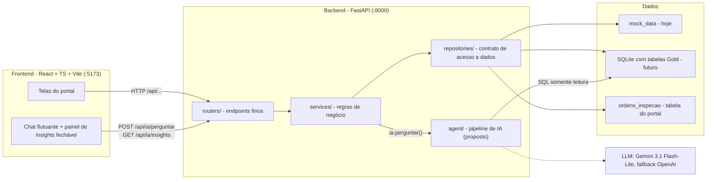
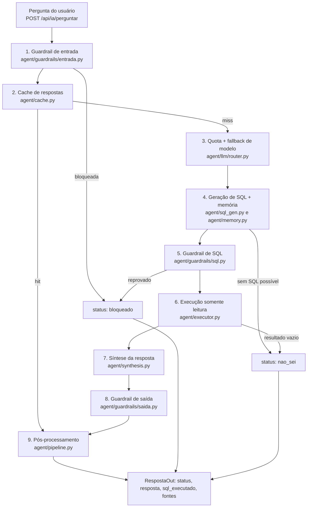

# Arquitetura do Backend — V-Energy Grid 360

Documento de alinhamento entre **Dev (front/back)** e **IA**. Mostra onde cada peça vive no backend e onde entram
os guardrails do agente. Os diagramas usam Mermaid (renderizam direto no GitHub).

Legenda: **[existe]** já está na branch `dev/estruturacao` · **[proposto]** sugestão para validar com o grupo.

---

## 1. Visão geral



Ideia central: **routers só chamam services; services só falam com repositories (dados do portal) ou com `agent/` (IA)**.
O agente nunca passa pelo repositório do portal: ele tem a sua própria conexão, somente leitura.

---

## 2. Mapa de pastas

> **Onde mora o agente (decisão pendente com a frente de IA).** O `AGENTS.md` da `main` reserva a pasta `ai-agent/`
> na raiz do repositório para a frente de IA, e o case pede que o agente seja um módulo Python integrado ao FastAPI.
> Duas formas de cumprir os dois: **(A)** código em `ai-agent/` (como pacote Python com nome sem hífen, ex.: `agente/`),
> instalado e importado pelo backend (`pip install -e ../ai-agent`), que segue a convenção do repositório;
> **(B)** `backend/app/agent/`, mais simples, mas fora da convenção. A árvore abaixo mostra a opção B só como exemplo;
> os caminhos `agent/...` deste documento são **relativos à pasta do agente** e valem para qualquer das duas.

```
backend/
├── app/
│   ├── main.py                  [existe] app FastAPI, CORS (front :5173), handlers 404/409
│   ├── schemas.py               [existe] modelos Pydantic (contrato com o front)
│   ├── core/
│   │   ├── config.py            [existe] settings via .env (DATA_SOURCE, SQLITE_PATH, CORS)
│   │   └── errors.py            [existe] NaoEncontrado (404), ConflitoDeEstado (409)
│   ├── mock/mock_data.py        [existe] dados fake determinísticos
│   ├── repositories/            [existe] acesso a dados do PORTAL
│   │   ├── base.py                       contrato (Protocol)
│   │   ├── mock_repo.py                  implementação mock
│   │   └── sqlite_repo.py                TODO: lê a Gold quando estiver pronta
│   ├── services/                [existe] regras de negócio
│   │   ├── receita.py · dashboard.py · unidades.py · perdas.py · continuidade.py
│   │   └── ia.py                         ponto de entrada do módulo de IA (hoje stub)
│   ├── routers/                 [existe] endpoints /api/...
│   │   ├── catalogos.py · dashboard.py · unidades.py · perdas.py · continuidade.py
│   │   └── ia.py                         POST /ia/perguntar · GET /ia/insights
│   └── agent/                   [proposto, opção B] tudo do agente de IA (na opção A, vira ai-agent/)
│       ├── pipeline.py                   orquestra os 9 passos (seção 4)
│       ├── guardrails/
│       │   ├── entrada.py                barreira de entrada
│       │   ├── sql.py                    barreira de segurança do SQL
│       │   └── saida.py                  barreira de saída
│       ├── cache.py                      cache de respostas (sem Redis)
│       ├── llm/
│       │   ├── router.py                 quota + fallback entre modelos
│       │   └── clientes.py               Gemini / OpenAI / OpenRouter
│       ├── sql_gen.py                    prompt + geração de SQL
│       ├── memory.py                     memória da conversa (janela deslizante)
│       ├── executor.py                   executa SQL em conexão somente leitura
│       ├── synthesis.py                  resposta em português a partir do resultado
│       ├── schema_context.py             descrição das tabelas Gold para o prompt
│       └── insights.py                   insights por tela (hoje em services/ia.py)
├── tests/                       [existe] pytest (+ tests/test_agent_*.py [proposto])
└── docs/
    ├── contrato-gold.md         [existe] o que o portal precisa da Gold (a fonte de verdade é docs/gold_contract.md)
    └── arquitetura-backend.md   este documento
```

Por que o agente fica separado de `services/`: o serviço `services/ia.py` fica fino (recebe a pergunta, chama
`agent.pipeline.executar(...)`, devolve `RespostaOut`). Assim o time de IA trabalha numa pasta própria, sem
conflito com Dev, e o contrato com o front não muda.

---

## 3. Rotas (`/api`)

| Método | Rota | Dono | Estado | Tela / user story |
|---|---|---|---|---|
| GET | `/health` | Dev | implementada | infraestrutura (API no ar e `data_source` ativo) |
| GET | `/filtros` | Dev | implementada (mock) | selects de filtros |
| GET | `/dashboard/kpis`, `/dashboard/serie` | Dev | implementada (mock) | visão do diretor |
| GET | `/receita/variacao?agrupar_por=municipio\|bairro\|classe` | Dev | implementada (mock) | efeito preço x volume (drill-down) |
| GET | `/unidades?q=`, `/unidades/{uc}/visao-360` | Dev | implementada (mock) | atendente |
| GET | `/perdas/fila?q=&pagina=&tamanho=` | Dev | implementada (mock) | fila priorizada, com busca e paginação (total no cabeçalho `X-Total-Count`) |
| POST/GET | `/perdas/ordens`, `/perdas/ordens/{id}` | Dev | implementada (em memória) | criar, listar e consultar ordens |
| POST | `/perdas/ordens/{id}/iniciar`, `/resultado`, `/cancelar` | Dev | implementada (em memória) | ciclo da ordem de inspeção |
| GET | `/continuidade/alimentadores`, `/alimentadores/{id}/serie` | Dev | implementada (mock) | DEC/FEC |
| **POST** | **`/ia/perguntar`** | **IA** | **stub** (`nao_implementado`) | chat flutuante |
| **DELETE** | **`/ia/sessoes/{id}`** | **IA** | **stub** (204, não faz nada) | "nova conversa" no chat |
| **GET** | **`/ia/insights?tela=`** | **IA** | **parcial** (ver abaixo) | painel de insights fechável |

"Mock" = devolve dados fictícios até a Gold chegar. "SQLite do portal" = as ordens ficam em `data/portal.db` (separado do `gold.db`) e sobrevivem a reinícios; o código está em `repositories/ordens_store.py`. Há no máximo uma ordem ativa (PENDENTE ou EM_CAMPO) por UC, garantido por um índice único parcial.

### Insights por tela (`tela` aceita: `dashboard`, `receita`, `unidades`, `perdas`, `continuidade`)

| Tela | Estado | Observação |
|---|---|---|
| `receita` | implementado | destaque do efeito preço x volume e pior município em volume |
| `continuidade` | implementado | alimentador com pior DEC no período |
| `dashboard`, `unidades`, `perdas` | vazio (`[]`) | aguardam a lista de indicadores que o grupo vai definir |

Valor de `tela` fora dessa lista retorna **422**. Os nomes das telas são uma proposta e devem bater com os do frontend.

Contrato atual do chat (`schemas.py`):

```
PerguntaIn   { pergunta: str (3-500), sessao_id: str | null }
RespostaOut  { status: "ok" | "nao_sei" | "nao_implementado",
               resposta: str, sql_executado: str | null, fontes: list[str] }
Insight      { tipo: "destaque" | "alerta" | "informativo", texto: str, dados: dict }
```

`sql_executado` + `fontes` atendem à user story de **auditar como a IA chegou à resposta**.

---

## 4. Fluxo do agente e onde cada guardrail entra

Fluxo definido na reunião de 19/10, mapeado para arquivos:



### O que cada guardrail precisa garantir (requisitos do case)

| Passo | Responsabilidade |
|---|---|
| 1. Entrada | Barrar prompt injection e pedidos fora do papel ("ignore as instruções", pedir para alterar dados, assuntos não relacionados à V-Energy). |
| 5. SQL | Aceitar **somente `SELECT`**; uma única instrução; sem `;` encadeado, `PRAGMA`, `ATTACH`, `DROP`, `INSERT`, `UPDATE`, `DELETE`; **lista permitida de tabelas** (só Gold); limite de linhas (`LIMIT`). |
| 6. Execução | Conexão **separada e somente leitura** (SQLite: `file:...?mode=ro`), com timeout. Nunca usar a mesma conexão do repositório do portal. |
| 8. Saída | Não vazar prompt/instruções, nem dados fora do resultado da consulta; resposta coerente com o que o SQL retornou. |
| 4/6/7. "Não sei" | Sem dado ou SQL inviável: responder `nao_sei` em vez de inventar. Dado inventado é pior que nenhum dado (pedido da Diretora de TI no case). |
| 9. Pós-proc. | Montar `sql_executado` e `fontes`, formatar números (R$, kWh) e registrar log para auditoria. |

### Memória e cache

- **Memória:** janela deslizante (decisão da reunião), guardada por `sessao_id`, para permitir perguntas de follow-up sem repetir contexto.
- **Cache:** a stack básica ficou **sem Redis**. Sugestão: dicionário em memória com TTL (ou uma tabela no SQLite do portal). Chave = pergunta normalizada.

---

## 5. Pontos de integração Dev x IA

1. **Entrada única:** `routers/ia.py` → `services/ia.py` → `agent.pipeline.executar(pergunta, sessao_id)`. Dev não mexe dentro de `agent/`; IA não mexe fora dele, exceto `schemas.py` (mudanças combinadas).
2. **Banco para o agente:** hoje o backend roda em `DATA_SOURCE=mock` (dicionários em Python), **sem SQL**. Na fase de benchmark (seção 7) a IA não depende do backend: usa um SQLite próprio com as tabelas brutas. Na integração, o agente passa a ler o SQLite com a Gold.
3. **Descrição do esquema:** `agent/schema_context.py` deve nascer de `docs/gold_contract.md` (contrato da frente de Dados) e ser atualizado quando a Gold fechar. O `docs/contrato-gold.md` do backend só lista o que o portal precisa receber.
4. **Segredos:** chaves de API (Gemini, OpenAI/OpenRouter) só em `.env` (já ignorado no Git); documentar os nomes das variáveis em `.env.example`.
5. **Insights:** `GET /ia/insights?tela=` já devolve insights calculados dos dados (fieis por construção); o LLM, se usado, só reescreve o texto.

---

## 6. Pendências e decisões em aberto

- [ ] **Cache x "sem Redis":** confirmar que o cache do agente será em memória/SQLite, sem componente novo.
- [ ] **"Janela de 3 sessões":** confirmar se são 3 sessões de conversa ou as últimas 3 interações da mesma sessão.
- [ ] **Novos valores de `status`:** adicionar `bloqueado` (guardrails) e, se necessário, `limite_excedido` (quota) em `RespostaOut`.
- [ ] **Tabelas Gold reais:** `schema_context.py` e a lista permitida do guardrail de SQL dependem do contrato da Gold (reunião de quinta).
- [ ] **Onde mora o agente:** `ai-agent/` (convenção do `AGENTS.md`) importado pelo backend, ou `backend/app/agent/`. Em ambos, é um módulo Python dentro do FastAPI (como pede o case), sem serviço separado.
- [ ] **Resultado do benchmark:** definir o modelo principal e a ordem de fallback para `agent/llm/router.py`.

---

## 7. Fases do módulo de IA

**Fase 1 — Benchmark de autonomia (agora, fora do backend).** A IA carrega as tabelas CSV brutas num SQLite
e mede se o agente consegue ler o esquema, gerar e executar SQL sozinho, para escolher modelo principal e fallbacks.
Não depende da Gold nem do portal.

**Fase 2 — Integração (depois da Gold).** Com os dados tratados, o agente entra no ecossistema completo
(`agent/` dentro do FastAPI, guardrails, cache, memória, rota `/api/ia/perguntar` e painel de insights).

Para a fase 1 render o máximo na fase 2:

- **Mesma interface do pipeline:** o benchmark chama uma função `perguntar(pergunta, sessao_id) -> RespostaOut`. Na integração, só muda a conexão do banco e o `schema_context`.
- **Medir o que o case cobra:** acerto do resultado contra um gabarito (SQL escrito à mão), comportamento de "não sei", resistência a prompt injection e tentativas de escrita, latência e custo por pergunta.
- **Dados sujos pesam no resultado:** os modelos podem se sair pior (ou diferente) do que sairão na Gold. Vale repetir uma rodada curta com a Gold quando ela existir, antes de fechar o fallback.
- **Dataset é confidencial:** o repositório é público, então CSVs, o `.db` do benchmark e o PDF do case ficam fora do Git (adicionar ao `.gitignore`).
